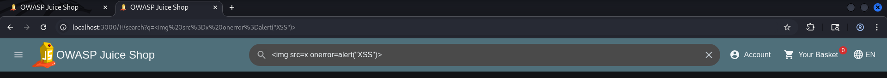
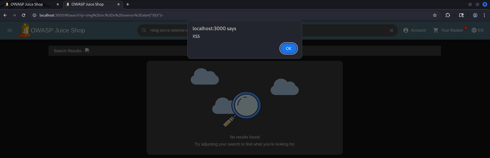

# Exploit Report: DOM-based Cross-Site Scripting (XSS)

## Vulnerability Overview

* **Vulnerability Type:** DOM-based Cross-Site Scripting (OWASP A03:2021 - Injection)
* **Target Endpoint:** Global Search Functionality (`http://localhost:3000/#/search`)
* **Vulnerable Parameter:** `q` (Query string parameter)
* **Severity:** High
* **Exploitation Status:** Successfully Exploited

---

## Technical Description

DOM-based XSS occurs entirely on the client side (in the browser). When a user searches for a product, the Angular-based frontend reads the `q` parameter directly from the client-side URL (`location.search` / `location.hash`) and renders it dynamically into the Document Object Model (DOM) without proper sanitization or context-aware output encoding.

---

## Proof of Concept & Exploitation Steps

### Step 1: Payload Construction

The following HTML payload was crafted using an broken `` tag to trigger the inline `onerror` JavaScript event handler:

```html

```

### Step 2: Execution Link

When URL-encoded and appended to the search path, the malicious link is constructed as follows:

```text
http://localhost:3000/#/search?q=%3Cimg%20src%3Dx%20onerror%3Dalert(%22XSS%22)%3E
```

### Step 3: Execution & Verification

1. Open the crafted URL in the browser or paste `` directly into the search bar.
2. The Angular framework attempts to render the image tag within the search component and results view.
3. Since the image source `x` fails to load, the browser immediately triggers the `onerror` handler, executing `alert("XSS")`.

---

## Evidence & Screenshots



*Figure 1: Injecting the malicious HTML image tag payload into the search input.*


*Figure 2: Successful DOM-based XSS execution triggering the JavaScript alert box via the onerror event.*

---

## Real-World Impact

* **Session Hijacking:** Attackers can read sensitive session tokens (such as JWTs stored in `localStorage` or `sessionStorage`) and steal user accounts.
* **Client-Side Actions:** Perform unauthorized actions on behalf of the victim (e.g., modifying user settings, adding items to basket, or making purchases).
* **Phishing & Defacement:** Dynamically modify page content (UI Redressing) to trick users into revealing sensitive credentials.

---

## Remediation & Mitigation

### 1. Context-Aware Output Encoding

Ensure all user-supplied data extracted from the URL or DOM is properly sanitized before rendering. In modern frameworks like Angular, use built-in DOM sanitizers (`DomSanitizer`) and avoid marking untrusted HTML as safe (`bypassSecurityTrustHtml`).

### 2. Avoid Dangerous DOM Sink Functions

Avoid utilizing dangerous sinks like `innerHTML`, `document.write()`, or `eval()` with untrusted input sources (`location.search`, `document.referrer`). Use safe alternatives like `textContent` or `innerText`.

### 3. Implement Content Security Policy (CSP)

Configure a robust Content Security Policy header to restrict the execution of inline scripts and untrusted inline event handlers:

```http
Content-Security-Policy: default-src 'self'; script-src 'self'; img-src 'self';
```
